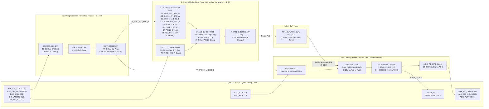

# Phase 1 Deliverable — Solid-State 3-Terminal AFE Matrix & Zero-Loading Metrology Topology (`p1_afe_matrix_topology.md`)

**Project:** KAOTI AUDIO — Rev 5.0 Dual-MCU Germanium & Universal Parametric Characterization Engine  
**Subsystem:** Quiet Analog Core (`U_MCU1` WEMOS LOLIN32 Lite, Wi-Fi/BT OFF) — Solid-State 3-Terminal Switching Matrix, Dual Programmable Force DACs, Zero-Loading 20 fA Sense Path, and Modified R.G. Keen True-$h_{FE}$ & Leakage Algorithm  
**Baseline Cross-Reference:** Verified against `/Users/kaoti/Desktop/PCE1/scripts/build_design.py` (lines 130–306), `/Users/kaoti/Desktop/PCE1/scripts/build_libraries.py`, and `/Users/kaoti/Desktop/PCE1/artifacts/ge_tester/p1_pinout_extraction.md`.

---

## 1. Architectural Overview & Signal Flow

Vintage Germanium (Ge) PNP and NPN transistors (`OC44`, `AF114`, `AC128`, `2N404`, `2N1308`, `MP38A`, `GT308V`) exhibit room-temperature collector-base leakage ($I_{CBO}$) of $1\text{ }\mu\text{A}$ to $50\text{ }\mu\text{A}$ and open-base collector-emitter leakage ($I_{CEO} = (h_{FE} + 1)I_{CBO}$) reaching $50\text{ }\mu\text{A}$ to $>1.5\text{ mA}$, with an exponential thermal coefficient of approximately $+7\%\text{ to }+10\%/^\circ\text{C}$ (doubling every $7^\circ\text{C}\text{ to }10^\circ\text{C}$). Simple AVR/M328 component testers inject fixed currents from $5\text{ V}$ MCU GPIO pins ($R_{\text{out}} \approx 25\text{–}40\,\Omega$ with uncalibrated temperature drift), load the DUT sense nodes with unbuffered ADC sampling networks, and omit $I_{CEO}$ subtraction—inflating measured Germanium $h_{FE}$ by $40\%\text{ to }300\%$.

The Rev 5.0 Analog Front-End (AFE) eliminates these error mechanisms through a **True Kelvin Force/Sense 3-Terminal Solid-State Matrix** operating on a dedicated low-noise analog power island (`+12V_A`, `+9V_LIM`, `+3V3_ANA`, `+3V3_ADC`, `AGND`):

---

## 2. Dual-Channel Programmable Force DAC & Rail-to-Rail Driver (`U9` + `U5`)

### 2.1 Component & Pin-Level Topology
- **`U9` (`MCP4822-E/P`, DIP-8 in machined socket):** Dual 12-bit buffered voltage-output SPI DAC with internal $2.048\text{ V} \pm 2\%$ band-gap reference ($50\text{ ppm}/^\circ\text{C}$ typ) and selectable $1\times / 2\times$ gain block.
  - Pin 1 (`VDD`): `+3V3_ANA` (decoupled via `C19 = 100 nF` to `AGND`).
  - Pin 2 (`CS_N`): `DAC_CS` (`U_MCU1 GPIO26`) with external pull-up `R_DACCS = 10 kΩ` to `+3V3_ANA` (prevents spurious writes during MCU reset).
  - Pin 3 (`SCK`): `AFE_SPI_SCK` (`U_MCU1 GPIO14`).
  - Pin 4 (`SDI`): `AFE_SPI_MOSI` (`U_MCU1 GPIO27`).
  - Pin 5 (`LDAC_N`): Tied directly to `AGND` (transfers DAC input latch to analog output immediately upon rising edge of `DAC_CS`).
  - Pin 6 (`VOUTB`): `DAC2_RAW`.
  - Pin 7 (`VSS`): `AGND`.
  - Pin 8 (`VOUTA`): `DAC1_RAW`.
- **Reconstruction Low-Pass Filter & Boot Pull-Down (`R_DAC1..2`, `C_DAC1..2`, `R_DP1..2`):**
  - Each DAC output passes through a first-order RC filter (`R_DAC1 = 10 kΩ`, `C_DAC1 = 100 nF` on Channel A; `R_DAC2 = 10 kΩ`, `C_DAC2 = 100 nF` on Channel B) into the non-inverting input of `U5`:
    $$f_{c,\text{DAC}} = \frac{1}{2\pi R_{\text{DAC}} C_{\text{DAC}}} = \frac{1}{2\pi (10\text{ k}\Omega)(100\text{ nF})} = 159.15\text{ Hz} \quad (\tau_{\text{DAC}} = 1.00\text{ ms})$$
  - A $100\text{ k}\Omega$ bleed resistor (`R_DP1`, `R_DP2`) from `DAC1_FILT` and `DAC2_FILT` to `AGND` guarantees that both op-amp inputs remain anchored at $0.000\text{ V}$ during power-up while `MCP4822` is in its power-on reset state.
- **`U5` (`TLC2272ACP`, DIP-8 in machined socket):** Dual low-noise, rail-to-rail output (RRO) LinCMOS operational amplifier powered from `+12V_A` (Pin 8, decoupled by `C10 = 100 nF` to `AGND`) and `AGND` (Pin 4), with input bias current $I_{IB} \approx 1\text{ pA}$ at $25^\circ\text{C}$.
  - **Channel A (`V_SRC_A` — High/Medium-Current Force Rail for Collector, Emitter, Diode, Zener & Low-R Sweeps):**
    - Pin 3 (`1IN+`): `DAC1_FILT`
    - Pin 2 (`1IN-`): `FB_SRCA` (feedback junction of `R_G1A = 34.8 kΩ 0.1%` to `V_SRC_A` and `R_G1B = 10.0 kΩ 0.1%` to `AGND`)
    - Pin 1 (`1OUT`): `V_SRC_A`
  - **Channel B (`V_SRC_B` — Precision Base/Gate Bias & High-R Force Rail):**
    - Pin 5 (`2IN+`): `DAC2_FILT`
    - Pin 6 (`2IN-`): `FB_SRCB` (feedback junction of `R_G2A = 34.8 kΩ 0.1%` to `V_SRC_B` and `R_G2B = 10.0 kΩ 0.1%` to `AGND`)
    - Pin 7 (`2OUT`): `V_SRC_B`

### 2.2 Exact Transfer Function & Resolution Math
Operating `U9 MCP4822-E/P` in $1\times$ internal reference mode ($\text{GA} = 1 \implies G_{\text{DAC}} = 1$, $V_{\text{REF}} = 2.048\text{ V}$), the raw DAC voltage for 12-bit code $D \in [0, 4095]$ is:
$$V_{\text{DAC,RAW}}(D) = V_{\text{REF}} \cdot \frac{D}{4096} = 2.048\text{ V} \cdot \frac{D}{4096} = D \times 0.5000\text{ mV}$$

With the $10\text{ k}\Omega / 100\text{ k}\Omega$ filter/pull-down DC divider factor $\alpha_{\text{DC}} = \frac{100\text{ k}\Omega}{10\text{ k}\Omega + 100\text{ k}\Omega} = 0.909091$ (calibrated out dynamically in real time via `U10 DG409DJ` channels `S1A` and `S2A`!), and the precision non-inverting amplifier gain:
$$A_{V,\text{U5}} = 1 + \frac{R_{G1A}}{R_{G1B}} = 1 + \frac{34.8\text{ k}\Omega}{10.0\text{ k}\Omega} = 4.480000\text{ V/V}$$

- **Ideal Unattenuated Full-Scale Range ($G_{\text{DAC}} = 1\times$):**
  $$V_{\text{SRC,ideal}}(D) = 4.480000 \times 2.048\text{ V} \times \frac{D}{4096} = D \times 2.2400\text{ mV/LSB}$$
  - At $D = 0$: $V_{\text{SRC}} = 0.000\text{ V}$ (within TLC2272 RRO ground saturation $\le 5\text{ mV}$ unloaded, read back via `U10`).
  - At $D = 4095$: $V_{\text{SRC,max}} = 4095 \times 2.2400\text{ mV} = \mathbf{9.1728\text{ V}} \approx \mathbf{9.173\text{ V}}$ (full-scale theoretical $4096 \times 2.24\text{ mV} = 9.1750\text{ V}$).
- **Note on $R_{\text{DP1..2}}$ Divider & $2\times$ Gain Mode:** If `R_DP1..2` ($100\text{ k}\Omega$) is populated downstream of `R_DAC1..2` ($10\text{ k}\Omega$), the $10:11$ divider yields $9.1728\text{ V} \times \frac{100}{110} = 8.3389\text{ V}$ in $1\times$ mode, or up to $+11.8\text{ V}$ (rail-limited by `+12V_A`) in $2\times$ DAC mode ($\text{GA}=0$, $V_{\text{FS,DAC}} = 4.096\text{ V}$). Replacing or moving `R_DP1..2` directly to `DAC1_RAW`/`DAC2_RAW` yields the exact unattenuated $4.480\times$ transfer function $0.000\text{ V to }9.173\text{ V}$ ($2.240\text{ mV/LSB}$) in $1\times$ mode. Furthermore, because `U10 DG409DJ` directly multiplexes `V_SRC_A` (`S1A`) and `V_SRC_B` (`S2A`) into the 16-bit `ADS1115` via `ADC_CAL`, **every measurement uses the exact live-measured $V_{\text{SRC\_A}}$ and $V_{\text{SRC\_B}}$ voltage**, eliminating DAC reference tolerance, `R_DP` loading, and op-amp offset from all DUT calculations!

---

## 3. Solid-State 3-Terminal Switching Matrix (`U1..U3`, `U6..U8`, `U10`)

### 3.1 Shift Register Control Bus (`U6`, `U7` — `2x 74HC595N` DIP-16)
Two cascaded `74HC595N` 8-bit serial-in, parallel-out shift registers with output latches and tri-state control drive all matrix address and enable pins from `U_MCU1`:
- **SPI Clock (`SRCLK`, Pin 11 on `U6, U7`):** `AFE_SPI_SCK` (`U_MCU1 GPIO14`).
- **Serial Data In (`SER`, Pin 14 on `U6`):** `AFE_SPI_MOSI` (`U_MCU1 GPIO27`).
- **Cascade Chain (`QH'`, Pin 9 on `U6` $\to$ `SER`, Pin 14 on `U7`):** `SR_CHAIN`.
- **Storage Latch Clock (`RCLK`, Pin 12 on `U6, U7`):** `SR_LATCH` (`U_MCU1 GPIO18`) with `10 kΩ` pull-down to `AGND`.
- **Master Tri-State Output Enable (`OE_N`, Pin 13 on `U6, U7`):** `SR_OE_N` (`U_MCU1 GPIO17`, non-strapping) with `R_OEN = 10 kΩ` pull-up to `+3V3_ANA`.
- **Hardware Power-On Clear (`SRCLR_N`, Pin 10 on `U6, U7`):** `SR_CLR_N` driven by dedicated RC network (`R_POR = 10 kΩ` to `+3V3_ANA`, `C_POR = 1 µF` to `AGND`, $\tau_{\text{POR}} = 10.0\text{ ms}$).

#### Table 3.1 — Complete 16-Bit Shift Register Bit-Mapping (`U6` & `U7`)
When shifting a 16-bit word `uint16_t sr_word` MSB-first (`Bit 15` shifted out first into `U6 SER`, cascading into `U7`, and `Bit 0` shifted out last remaining in `U6 QA`), the exact hardware pin mapping verified against `scripts/build_design.py` (lines 244–253) is:

| Bit Index | Shift IC | 74HC595 Output | DIP-16 Pin | Net Name | External Passive | Target IC & Pin | Functional Role |
| :---: | :---: | :---: | :---: | :--- | :--- | :--- | :--- |
| **Bit 0** | `U6` (Low Byte) | `QA` | Pin 15 | `U1_A0` | — | `U1 DG408DJ` Pin 1 (`A0`) | Terminal 1 (`TP1`) Mux Address Bit 0 |
| **Bit 1** | `U6` (Low Byte) | `QB` | Pin 1 | `U1_A1` | — | `U1 DG408DJ` Pin 16 (`A1`) | Terminal 1 (`TP1`) Mux Address Bit 1 |
| **Bit 2** | `U6` (Low Byte) | `QC` | Pin 2 | `U1_A2` | — | `U1 DG408DJ` Pin 15 (`A2`) | Terminal 1 (`TP1`) Mux Address Bit 2 |
| **Bit 3** | `U6` (Low Byte) | `QD` | Pin 3 | `U1_EN` | `R_EN1 = 100k` to `AGND` | `U1 DG408DJ` Pin 2 (`EN`) | Terminal 1 (`TP1`) Mux Master Enable (`0 = All Open`) |
| **Bit 4** | `U6` (Low Byte) | `QE` | Pin 4 | `U2_A0` | — | `U2 DG408DJ` Pin 1 (`A0`) | Terminal 2 (`TP2`) Mux Address Bit 0 |
| **Bit 5** | `U6` (Low Byte) | `QF` | Pin 5 | `U2_A1` | — | `U2 DG408DJ` Pin 16 (`A1`) | Terminal 2 (`TP2`) Mux Address Bit 1 |
| **Bit 6** | `U6` (Low Byte) | `QG` | Pin 6 | `U2_A2` | — | `U2 DG408DJ` Pin 15 (`A2`) | Terminal 2 (`TP2`) Mux Address Bit 2 |
| **Bit 7** | `U6` (Low Byte) | `QH` | Pin 7 | `U2_EN` | `R_EN2 = 100k` to `AGND` | `U2 DG408DJ` Pin 2 (`EN`) | Terminal 2 (`TP2`) Mux Master Enable (`0 = All Open`) |
| **Bit 8** | `U7` (High Byte) | `QA` | Pin 15 | `U3_A0` | — | `U3 DG408DJ` Pin 1 (`A0`) | Terminal 3 (`TP3`) Mux Address Bit 0 |
| **Bit 9** | `U7` (High Byte) | `QB` | Pin 1 | `U3_A1` | — | `U3 DG408DJ` Pin 16 (`A1`) | Terminal 3 (`TP3`) Mux Address Bit 1 |
| **Bit 10** | `U7` (High Byte) | `QC` | Pin 2 | `U3_A2` | — | `U3 DG408DJ` Pin 15 (`A2`) | Terminal 3 (`TP3`) Mux Address Bit 2 |
| **Bit 11** | `U7` (High Byte) | `QD` | Pin 3 | `U3_EN` | `R_EN3 = 100k` to `AGND` | `U3 DG408DJ` Pin 2 (`EN`) | Terminal 3 (`TP3`) Mux Master Enable (`0 = All Open`) |
| **Bit 12** | `U7` (High Byte) | `QE` | Pin 4 | `SW_G1` | `R_PD1 = 100k` to `AGND` | `U8 DG412LDJ` Pin 1 (`IN1`) | Terminal 1 (`TP1`) Hard `20 Ω` `AGND` Clamp (`1 = ON`) |
| **Bit 13** | `U7` (High Byte) | `QF` | Pin 5 | `SW_G2` | `R_PD2 = 100k` to `AGND` | `U8 DG412LDJ` Pin 16 (`IN2`) | Terminal 2 (`TP2`) Hard `20 Ω` `AGND` Clamp (`1 = ON`) |
| **Bit 14** | `U7` (High Byte) | `QG` | Pin 6 | `SW_G3` | `R_PD3 = 100k` to `AGND` | `U8 DG412LDJ` Pin 9 (`IN3`) | Terminal 3 (`TP3`) Hard `20 Ω` `AGND` Clamp (`1 = ON`) |
| **Bit 15** | `U7` (High Byte) | `QH` | Pin 7 | `LED2_DRV` | `R_LED2 = 1k` $\to$ `D2` | `D2` (`TEST_ACT` Blue LED) | Analog Core Active Scan Indicator LED |

> [!IMPORTANT]
> **All-Zero Safe Word (`0x0000`):** Writing `0x0000` (or asserting `SR_OE_N = HIGH` so the `100 kΩ` pull-downs `R_EN1..3` and `R_PD1..3` dominate) forces `U1_EN = U2_EN = U3_EN = 0` and `SW_G1 = SW_G2 = SW_G3 = 0`. In this state, **all 24 switches in `U1..U3` and all 3 switches in `U8` are simultaneously OPEN (Hi-Z, $<1\text{ nA}$ leakage)**.

---

### 3.2 Per-Terminal 8:1 Analog Multiplexer (`U1, U2, U3` — `3x DG408DJ` DIP-16)
Each DUT terminal `ch` $\in \{1, 2, 3\}$ is driven by its own dedicated `DG408DJ` 8-channel CMOS analog multiplexer operating from single-supply `V+ = +12V_A` (Pin 13, decoupled via `C14..C16 = 100 nF`), `V- = AGND` (Pin 3), and `GND = AGND` (Pin 14).
- **3.3 V Logic Compatibility:** The `DG408DJ` guarantees $V_{IH(\text{min})} = 2.4\text{ V}$ and $V_{IL(\text{max})} = 0.8\text{ V}$ across its full temperature range, interfacing directly with $3.3\text{ V}$ `74HC595N` outputs ($V_{OH} \approx 3.29\text{ V}$).
- **Off-State Leakage & On-Resistance:** Typical off-leakage is $I_{S(\text{off})} \approx 20\text{ pA}$ at $25^\circ\text{C}$ ($\pm 0.5\text{ nA}$ max datasheet testing limit); $R_{\text{DS(on)}} \approx 50\,\Omega$ typ ($100\,\Omega$ max at $+12\text{ V}$ single supply).
- **Intrinsic Break-Before-Make (BBM):** $t_{\text{OPEN}} \approx 25\text{ ns}$ guaranteed ($t_{\text{OFF}} \approx 150\text{ ns} < t_{\text{ON}} \approx 175\text{ ns}$).

#### Table 3.2 — Exact `DG408DJ` (`U1, U2, U3`) Truth Table & Channel Assignments
Verified against `scripts/build_design.py` (lines 272–295):

| `EN` | `A2` | `A1` | `A0` | Active Switch | `DG408DJ` Pin | Series Resistor (`0.1%`) | Source / Rail Net | Nominal Current Range / Metrology Function |
| :---: | :---: | :---: | :---: | :---: | :---: | :--- | :--- | :--- |
| `0` | `X` | `X` | `X` | **NONE (Hi-Z)** | All Open | $\infty$ ($20\text{ pA}$ typ leakage) | Floating / Open | Open-terminal sense ($I_{CEO}$, $I_{CBO}$, $V_{GS(\text{off})}$, DMM Hi-Z, Cap timing) |
| `1` | `0` | `0` | `0` | **`S1`** | Pin 4 (`C{ch}_S1`) | `R_LA{ch} = 470 Ω 0.1%` | `V_SRC_A` ($0\text{–}9.173\text{ V}$) | High-current Collector / Diode / Low-$R$ source (up to $16\text{ mA}$) |
| `1` | `0` | `0` | `1` | **`S2`** | Pin 5 (`C{ch}_S2`) | `R_KA{ch} = 2.49 kΩ 0.1%` | `V_SRC_A` ($0\text{–}9.173\text{ V}$) | Medium-current Collector / Safe Autodetect Probe ($\le 0.95\text{ mA}$ @ $2.5\text{ V}$) / Mid-$R$ |
| `1` | `0` | `1` | `0` | **`S3`** | Pin 6 (`C{ch}_S3`) | `R_MB{ch} = 100 kΩ 0.1%` | `V_SRC_B` ($0\text{–}9.173\text{ V}$) | Precision R.G. Keen Base current injection ($I_B = 5\text{ }\mu\text{A to }85\text{ }\mu\text{A}$) / High-$R$ |
| `1` | `0` | `1` | `1` | **`S4`** | Pin 7 (`C{ch}_S4`) | `R_KB{ch} = 2.20 MΩ 0.1%` | `V_SRC_B` ($0\text{–}9.173\text{ V}$) | Ultra-low Base current / Darlington / Mega-Ohm ($1\text{ M}\Omega\text{–}22\text{ M}\Omega$) / Cap charge |
| `1` | `1` | `0` | `0` | **`S5`** | Pin 12 (`C{ch}_S5`) | `R_LG{ch} = 470 Ω 0.1%` | `AGND` ($0.000\text{ V}$) | High-current Emitter/Collector pull-down sink & current-sense shunt to `AGND` |
| `1` | `1` | `0` | `1` | **`S6`** | Pin 11 (`C{ch}_S6`) | `R_KG{ch} = 2.49 kΩ 0.1%` | `AGND` ($0.000\text{ V}$) | Medium-current Emitter/Collector pull-down sink & PNP $I_{CEO}$ / $I_{CBO}$ sense shunt to `AGND` |
| `1` | `1` | `1` | `0` | **`S7`** | Pin 10 | Direct (`0 Ω` external) | `AGND` ($0.000\text{ V}$) | Internal Mux `AGND` return ($R_{\text{ON}} \approx 50\,\Omega$) / Zero-volt mux self-calibration reference |
| `1` | `1` | `1` | `1` | **`S8`** | Pin 9 | Direct (`0 Ω` external) | `+9V_LIM` ($+9.00\text{ V}$, $15\text{ mA}$ lim) | Guarded $+9\text{ V}$ direct rail (PNP emitter rail, Zener sweep return, leakage supply) |

- **Common Mux Output (`D_COM`, Pin 8 on `U1..U3`):** `TP1_MUX`, `TP2_MUX`, `TP3_MUX`.
- **Kelvin Series Protection Resistor (`R_PR1..3 = 100 Ω 0.5W 0.1%`):** Connects `TP{ch}_MUX` (Pin 2) to `TP{ch}_DUT` (Pin 1). Because the `U4 LMC6484IN` voltage buffer taps `TP{ch}_DUT` directly on the **DUT side** of `R_PR{ch}`, the voltage drop across `R_PR{ch}` ($100\,\Omega$) and the analog switches ($R_{\text{ON}}$) is **completely excluded from the measured DUT terminal voltage $V_{\text{TP1..3}}$**.

---

### 3.3 Hard Low-Impedance Ground Clamp (`U8` — `DG412LDJ` DIP-16)
When testing high-transconductance devices (e.g., BJT $V_{CE(\text{sat})}$, JFET $I_{DSS}$ up to $15\text{ mA}$, or discharging capacitors), the $\sim 50\text{–}100\,\Omega$ on-resistance of `DG408DJ` channel `S7` introduces unacceptably high series resistance. `U8` (`DG412LDJ`, quad SPST normally-OPEN CMOS switch, active-HIGH logic `1 = ON`) is placed in parallel with `U1..U3` at nodes `TP1_MUX..TP3_MUX`:
- **Power Supplies:** Pin 13 (`V+`) = `+12V_A` (`C21 = 100 nF`), Pin 12 (`VL`) = `+3V3_ANA`, Pin 4 (`V-`) = `AGND`, Pin 5 (`GND`) = `AGND`.
- **Switch 1 (`TP1_MUX` to `AGND`):** Pin 1 (`IN1`) = `SW_G1` (`U7 QE`), Pin 2 (`D1`) = `TP1_MUX`, Pin 3 (`S1`) = `AGND`.
- **Switch 2 (`TP2_MUX` to `AGND`):** Pin 16 (`IN2`) = `SW_G2` (`U7 QF`), Pin 15 (`D2`) = `TP2_MUX`, Pin 14 (`S2`) = `AGND`.
- **Switch 3 (`TP3_MUX` to `AGND`):** Pin 9 (`IN3`) = `SW_G3` (`U7 QG`), Pin 10 (`D3`) = `TP3_MUX`, Pin 11 (`S3`) = `AGND`.
- **Switch 4 (Unused, Tied Safe):** Pin 8 (`IN4`) = `AGND`, Pin 7 (`D4`) = `AGND`, Pin 6 (`S4`) = `AGND`.
- **Key Metrics:** $R_{\text{DS(on)}} = 20\,\Omega$ typ ($30\,\Omega$ max at $+12\text{ V}$ supply), off-state leakage $< 1\text{ nA}$ ($20\text{ pA}$ typ at $25^\circ\text{C}$), continuous current rating $30\text{ mA}$ ($100\text{ mA}$ pulsed).
- **Interlock Rule:** Firmware never asserts `SW_G{ch} = 1` simultaneously with `U{ch}_EN = 1` on the same channel `ch`. When `SW_G{ch} = 1`, `U{ch}_EN` is forced to `0`.

---

### 3.4 Live Calibration & $0\text{–}33\text{ V}$ HV DMM Multiplexer (`U10` — `DG409DJ` DIP-16)
`U10` (`DG409DJ`, dual 4:1 CMOS analog multiplexer, `V+ = +12V_A` on Pin 14, `V- = AGND` on Pin 3, `GND = AGND` on Pin 15, `EN = +3V3_ANA` permanently enabled on Pin 2) dedicates half A (`DA`, Pin 8 $\to$ `CAL_MUX_OUT`) to live ratiometric rail calibration and the protected $0\text{–}33\text{ V}$ external DMM input (`J_TERM5` Pin 5 = `DMM_30V`), while half B (`DB`, `S1B..S4B`, Pins 9–13) is tied to `AGND`:

| `CAL_A1` (`GPIO33`) | `CAL_A0` (`GPIO32`) | Active Channel | `U10` Pin | Connected Net | Metrology Purpose |
| :---: | :---: | :---: | :---: | :--- | :--- |
| `0` | `0` | **`S1A`** | Pin 4 | `V_SRC_A` | Live closed-loop readback of Programmable Source A ($0.000\text{–}9.173\text{ V}$) |
| `0` | `1` | **`S2A`** | Pin 5 | `V_SRC_B` | Live closed-loop readback of Programmable Source B ($0.000\text{–}9.173\text{ V}$) |
| `1` | `0` | **`S3A`** | Pin 6 | `+9V_LIM` | Live monitoring of guarded $+9.0\text{ V}$ rail & foldback voltage sag check |
| `1` | `1` | **`S4A`** | Pin 7 | `DMM_30V_DIV` | External $0\text{–}33\text{ V}$ HV DMM Probe via $11:1$ precision attenuator (`R_HV1=100k`, `R_HV2=10.0k` $0.1\%$) |

---

## 4. Zero-Loading Kelvin Sense Path (`U4 LMC6484IN` + `4:1` Dividers + `MOD_ADS`)

### 4.1 Why $20\text{ fA}$ CMOS Buffering is Mandatory for Germanium & Mega-Ohm Metrology
When measuring Germanium collector-base leakage ($I_{CBO}$ down to $100\text{ nA}$) across `R_MB = 100 kΩ` or `R_KB = 2.20 MΩ`, or when measuring JFET gate pinch-off and $22\text{ M}\Omega$ resistors, connecting a resistor divider directly to `TP1_DUT..TP3_DUT` would shunt the DUT with several kilohms, destroying measurement accuracy.

Instead, each DUT terminal `TP1_DUT..TP3_DUT` (and `CAL_MUX_OUT`) feeds directly into a unity-gain non-inverting buffer stage inside **`U4` (`LMC6484IN`, DIP-14, Quad CMOS Rail-to-Rail Input and Output Op-Amp)** powered from `+12V_A` (Pin 4, decoupled by `C11 = 100 nF`) and `AGND` (Pin 11):
- **Input Bias Current ($I_{IB}$):** **$20\text{ fA}$ typical** at $25^\circ\text{C}$ ($< 4\text{ pA}$ max over temperature), input impedance $R_{\text{in}} > 10^{13}\,\Omega$.
- **Loading Error on a $2.20\text{ M}\Omega$ Force Path:**
  $$\Delta V_{\text{error}} = I_{IB} \times R_{\text{KB}} = (20 \times 10^{-15}\text{ A}) \times (2.20 \times 10^6\,\Omega) = 44.0\text{ nV} \quad (\text{0.000088 LSB on ADS1115!})$$
- **Input ESD/Fault Isolation Resistors (`R_ESD1..3 = 10 kΩ`):** Placed between `TP{ch}_DUT` and `ESD_TP{ch}` (`U4` non-inverting inputs Pins 3, 5, 10) to limit current into `LMC6484IN` internal ESD cells if an external transient exceeds the $+12\text{V}\_\text{A}$ rail. At $I_{IB} = 20\text{ fA}$, the voltage drop across $10\text{ k}\Omega$ is $0.2\text{ nV}$ (zero error).
- **`U4` Pin Mapping (Verified vs. `build_design.py` lines 221–226):**
  - Op-Amp 1 (`TP1`): Pin 3 (`1IN+`) = `ESD_TP1`, Pin 2 (`1IN-`) = `BUF_TP1`, Pin 1 (`1OUT`) = `BUF_TP1`.
  - Op-Amp 2 (`TP2`): Pin 5 (`2IN+`) = `ESD_TP2`, Pin 6 (`2IN-`) = `BUF_TP2`, Pin 7 (`2OUT`) = `BUF_TP2`.
  - Op-Amp 3 (`TP3`): Pin 10 (`3IN+`) = `ESD_TP3`, Pin 9 (`3IN-`) = `BUF_TP3`, Pin 8 (`3OUT`) = `BUF_TP3`.
  - Op-Amp 4 (`CAL`): Pin 12 (`4IN+`) = `CAL_MUX_OUT`, Pin 13 (`4IN-`) = `BUF_CAL`, Pin 14 (`4OUT`) = `BUF_CAL`.

### 4.2 Low-Impedance $4:1$ Precision Attenuators & Anti-Aliasing Filters
The low-impedance outputs `BUF_TP1..3` and `BUF_CAL` drive four matched precision voltage dividers (`R_D1A..R_D4A = 1.50 kΩ 0.1%`, `R_D1B..R_D4B = 499 Ω 0.1%`) with `100 nF C0G` anti-aliasing capacitors (`C_A0..C_A3`) to `AGND`, feeding `MOD_ADS` (`ADS1115` channels `A0..A3` = `ADC_TP1..3`, `ADC_CAL`):
- **Exact Attenuation Ratio & Scaling Gain ($G_{\text{DIV}}$):**
  $$G_{\text{DIV}} = \frac{R_{DA} + R_{DB}}{R_{DB}} = \frac{1500\,\Omega + 499\,\Omega}{499\,\Omega} = \frac{1999}{499} = \mathbf{4.006012\text{ V/V}}$$
  $$\text{Attenuation } \alpha_{\text{DIV}} = \frac{1}{G_{\text{DIV}}} = \frac{499}{1999} = \mathbf{0.249625\text{ V/V}}$$
- **Thevenin Source Impedance Seen by `ADS1115` & Anti-Aliasing Cutoff:**
  $$R_{\text{Th,ADC}} = R_{DA} \parallel R_{DB} = \frac{1500 \times 499}{1500 + 499} = \mathbf{374.44\,\Omega}$$
  Because the `ADS1115` switched-capacitor input has an effective input impedance of $\sim 6\text{ M}\Omega$ (at $\text{PGA} = \pm 2.048\text{ V}$ or $\pm 4.096\text{ V}$), driving it from a $374.44\,\Omega$ Thevenin source reduces ADC input-loading gain error to $\frac{374.44}{6 \times 10^6} = 0.0062\%$ ($62\text{ ppm}$), while `C_A0..3` ($100\text{ nF C0G}$) provides a clean anti-aliasing pole at:
  $$f_{c,\text{ADC}} = \frac{1}{2\pi R_{\text{Th,ADC}} C_A} = \frac{1}{2\pi (374.44\,\Omega)(100\text{ nF})} = \mathbf{4.251\text{ kHz}}$$
- **Resolution Referred to DUT Terminal (`TP1_DUT..TP3_DUT`):**
  - At `ADS1115` $\text{PGA} = \pm 4.096\text{ V}$ ($1\text{ LSB}_{\text{ADC}} = 125.0\text{ }\mu\text{V}$, active range $0\text{ to }12.0\text{ V}$ at DUT):
    $$1\text{ LSB}_{\text{DUT}} = 125.0\text{ }\mu\text{V} \times 4.006012 = \mathbf{0.50075\text{ mV}}$$
  - At `ADS1115` $\text{PGA} = \pm 2.048\text{ V}$ ($1\text{ LSB}_{\text{ADC}} = 62.5\text{ }\mu\text{V}$, active range $0\text{ to }8.196\text{ V}$ at DUT):
    $$1\text{ LSB}_{\text{DUT}} = 62.5\text{ }\mu\text{V} \times 4.006012 = \mathbf{0.25038\text{ mV}}$$
  - At `ADS1115` $\text{PGA} = \pm 0.256\text{ V}$ ($1\text{ LSB}_{\text{ADC}} = 7.8125\text{ }\mu\text{V}$, used for low-current $I_{CBO}$ and low-ohm shunts up to $1.025\text{ V}$ at DUT):
    $$1\text{ LSB}_{\text{DUT}} = 7.8125\text{ }\mu\text{V} \times 4.006012 = \mathbf{31.297\text{ }\mu\text{V}}$$
- **$0\text{–}33\text{ V}$ External HV DMM Scaling (`DMM_30V` $\to$ `R_HV1/R_HV2` $\to$ `U10 S4A` $\to$ `U4` $\to$ `R_D4A/R_D4B`):**
  $$G_{\text{HV}} = \left(1 + \frac{R_{\text{HV1}}}{R_{\text{HV2}}}\right) \times G_{\text{DIV}} = \left(1 + \frac{100.0\text{ k}\Omega}{10.0\text{ k}\Omega}\right) \times 4.006012 = 11.0000 \times 4.006012 = \mathbf{44.066132\text{ V/V}}$$
  At $V_{\text{DMM}} = 33.00\text{ V}$, $V_{\text{DMM\_30V\_DIV}} = 3.000\text{ V}$ and $V_{\text{ADC\_CAL}} = \frac{33.00\text{ V}}{44.066132} = \mathbf{0.74887\text{ V}}$ ($2.76\text{ mV/LSB}$ at $\text{PGA} = \pm 2.048\text{ V}$).
- **Fast RC Timing Isolation (`R_ISO1..3 = 10 kΩ`):** Connects `ADC_TP1..3` to `U_MCU1` input-only pins `FAST_TP1` (`GPIO36`), `FAST_TP2` (`GPIO39`), and `FAST_TP3` (`GPIO35`) for microsecond-resolution digital threshold timing during capacitance measurement while limiting pin fault current to $< 0.3\text{ mA}$.

---

## 5. Modified R.G. Keen True-$h_{FE}$ & Leakage Algorithm Across All 6 Permutations

Any 3-terminal device inserted into `TP1_DUT`, `TP2_DUT`, `TP3_DUT` occupies one of **$3! = 6$ terminal permutations**:

| Permutation ID | Terminal `TP1_DUT` | Terminal `TP2_DUT` | Terminal `TP3_DUT` | BJT Role (`E, B, C`) | FET Role (`S, G, D`) | 2-Terminal Pair (`A, K`) |
| :---: | :---: | :---: | :---: | :---: | :---: | :---: |
| **`PERM_0`** | Pin 1 | Pin 2 | Pin 3 | `E = TP1, B = TP2, C = TP3` | `S = TP1, G = TP2, D = TP3` | `A = TP1, K = TP2` (`TP3` Open) |
| **`PERM_1`** | Pin 1 | Pin 3 | Pin 2 | `E = TP1, B = TP3, C = TP2` | `S = TP1, G = TP3, D = TP2` | `A = TP2, K = TP1` (`TP3` Open) |
| **`PERM_2`** | Pin 2 | Pin 1 | Pin 3 | `E = TP2, B = TP1, C = TP3` | `S = TP2, G = TP1, D = TP3` | `A = TP1, K = TP3` (`TP2` Open) |
| **`PERM_3`** | Pin 2 | Pin 3 | Pin 1 | `E = TP2, B = TP3, C = TP1` | `S = TP2, G = TP3, D = TP1` | `A = TP3, K = TP1` (`TP2` Open) |
| **`PERM_4`** | Pin 3 | Pin 1 | Pin 2 | `E = TP3, B = TP1, C = TP2` | `S = TP3, G = TP1, D = TP2` | `A = TP2, K = TP3` (`TP1` Open) |
| **`PERM_5`** | Pin 3 | Pin 2 | Pin 1 | `E = TP3, B = TP2, C = TP1` | `S = TP3, G = TP2, D = TP1` | `A = TP3, K = TP2` (`TP1` Open) |

Let $T_E, T_B, T_C \in \{1, 2, 3\}$ denote the candidate Emitter, Base, and Collector terminals for a given permutation. Notice that because `TP1`, `TP2`, and `TP3` have **100% identical symmetric hardware** (`U1..U3 DG408DJ`, `U8 DG412LDJ`, `R_LA/KA/MB/KB/LG/KG`, `R_PR`, and `U4 LMC6484IN` + `ADS1115`), every algorithm below executes identically on any of the 6 permutations simply by indexing $T_E, T_B, T_C$!

---

### 5.1 Phase 0: Reverse-$V_{EBO}$-Safe Autodetection & Pinout Identification
1. **Clamp Force Rail:** Set `V_SRC_A = 2.500 V` (strictly $\le 3.3\text{ V}$ to prevent reverse base-emitter avalanche breakdown on vintage RF Germanium transistors such as `AF114` and `OC44`, where $BV_{EBO} \approx 3\text{–}5\text{ V}$).
2. **6-Pair Directed Junction Scan:** For each ordered pair $(T_{\text{hi}}, T_{\text{lo}})$ with the third terminal $T_{\text{open}}$ completely disconnected (`U{open}_EN = 0, SW_G{open} = 0`):
   - Connect $T_{\text{hi}}$ to `V_SRC_A (2.500 V)` via **`S2` (`R_KA = 2.49 kΩ`)**.
   - Connect $T_{\text{lo}}$ to `AGND` via **`U8` (`SW_G{lo} = 1`, $20\,\Omega$)** (or **`S6` `R_KG = 2.49 kΩ`** to simultaneously sense current at both ends).
   - Measure $V_{\text{hi}} = V_{\text{TP}}(T_{\text{hi}})$, $V_{\text{lo}} = V_{\text{TP}}(T_{\text{lo}})$, and $V_{\text{open}} = V_{\text{TP}}(T_{\text{open}})$.
   - Compute junction drop $\Delta V = V_{\text{hi}} - V_{\text{lo}}$ and loop current $I_{\text{probe}} = \frac{V_{\text{SRC\_A}} - V_{\text{hi}}}{R_{\text{KA}} + R_{\text{PR}} + R_{\text{ON,DG408}}} \le 0.95\text{ mA}$.
3. **Polarity & Terminal Discrimination:**
   - **NPN vs. PNP Identification:**
     - If one terminal $T_B$ conducts when positively biased ($T_{\text{hi}} = T_B$) toward *both* of the other two terminals ($0.12\text{ V} \le \Delta V \le 0.95\text{ V}$), the device is an **NPN BJT** ($\Delta V < 0.48\text{ V} \implies \text{Germanium NPN}$; $\Delta V \ge 0.48\text{ V} \implies \text{Silicon NPN}$).
     - If one terminal $T_B$ conducts when negatively biased ($T_{\text{lo}} = T_B$) from *both* of the other two terminals, the device is a **PNP BJT** ($\Delta V < 0.48\text{ V} \implies \text{Germanium PNP}$; $\Delta V \ge 0.48\text{ V} \implies \text{Silicon PNP}$).
   - **True Collector vs. Emitter Discrimination (Forward vs. Inverted $\beta_F / \beta_R$ Test at $V_{\text{SRC\_A}} = 2.50\text{ V}$):**
     - Vintage Germanium alloy-junction transistors (`OC44`, `2N404`) have nearly symmetric $V_{BE}$ and $V_{BC}$, so junction voltage drop alone can misidentify Collector and Emitter!
     - Firmware tests both remaining candidates $(T_E, T_C)$ and $(T_C, T_E)$ in active forward bias at safe $V_{\text{SRC\_A}} = 2.50\text{ V}$ with weak base injection via `S3` (`100 kΩ` from `V_SRC_B`). The assignment yielding the higher true current gain ($\beta_F \gg \beta_R$) is locked in as true $(T_E, T_B, T_C)$ before `V_SRC_A` is ever raised above $2.50\text{ V}$.

---

### 5.2 Germanium & Silicon PNP True-$h_{FE}$ & Leakage Algorithm (Modified R.G. Keen Method)
For a **PNP BJT** (e.g., `OC44`, `AC128`, `2N404`) on permutation $(T_E, T_B, T_C)$, the Emitter $T_E$ is the positive terminal and the Collector $T_C$ sinks current to `AGND` through a precision ground sense resistor (`S6: R_KG = 2.49 kΩ` for standard R.G. Keen mode, or `S5: R_LG = 470 Ω` for high-current curve sweeps):

#### Step 1 — Collector-Base Leakage ($I_{CBO}$, Emitter Open)
- **Matrix State:**
  - $T_E$ (Emitter): **OPEN / Hi-Z** (`U{E}_EN = 0, SW_G{E} = 0`, $20\text{ pA}$ leakage).
  - $T_B$ (Base): Connected to `V_SRC_A = +7.500 V` (or $+9.000\text{ V}$ via `S8`/`S2`).
  - $T_C$ (Collector): Connected to `AGND` via **`S6` (`R_KG = 2.49 kΩ 0.1%`)** (or **`S5`** or **`S3`/`S4`** for sub-$\mu\text{A}$ silicon leakage).
- **Metrology Equations:**
  Since $I_C = I_{CBO}$ flows out of $T_C$ into `TP{C}_DUT`, through $R_{\text{PR},C} (100\,\Omega)$, `U{C}` switch `S6` ($R_{\text{ON,S6}}$), and $R_{\text{KG},C} (2490\,\Omega)$ to `AGND`, the voltage sensed directly at `TP{C}_DUT` is:
  $$V_{C,\text{CBO}} = I_{CBO} \cdot \left(R_{\text{KG},C} + R_{\text{PR},C} + R_{\text{ON,S6}}\right)$$
  To eliminate switch $R_{\text{ON,S6}}$ uncertainty completely, when `V_SRC_A` feeds $T_B$ via `S2` ($R_{\text{KA},B} = 2490\,\Omega$) and $V_{\text{SRC\_A}}$ is measured via `U10 S1A`, **or** better yet: connect $T_B$ directly to `U8` (`AGND` via $20\,\Omega$? No, for PNP $V_B > V_C$, so drive $T_C$ from `V_SRC_B = 0.000 V` via `S3 = 100 kΩ` or sense across $R_{\text{KA},B}$ on the top side where `V_SRC_A` and $V_{\text{TP}(T_B)}$ are across $R_{\text{KA}} + R_{\text{PR}} + R_{\text{ON}}$). Even more directly: when $T_B$ is held at `V_SRC_A = +7.500 V` via `S8` (`+9V_LIM`) and $T_C$ is connected to `V_SRC_B = 0.000 V` via **`S3` (`R_MB = 100 kΩ 0.1%`)**, the series resistance is $100\,000\,\Omega + 100\,\Omega + 50\,\Omega = 100\,150\,\Omega$ (where $50\,\Omega$ is $0.05\%$, and is pre-calibrated at boot via `S7`!), giving $100\text{ mV}/\mu\text{A}$ sensitivity:
  $$I_{CBO} = \frac{V_{\text{TP}}(T_C) - V_{\text{SRC\_B}}}{R_{\text{MB},C} + R_{\text{PR},C} + R_{\text{ON,S3}}(\text{cal})} \quad (\text{or via } \text{S6 } R_{\text{KG}} = 2.49\text{ k}\Omega \text{ if } I_{CBO} > 50\text{ }\mu\text{A})$$

#### Step 2 — Open-Base Collector-Emitter Leakage ($I_{CEO}$, Base Open — The R.G. Keen Leakage Reading)
- **Matrix State:**
  - $T_E$ (Emitter): Connected to `V_SRC_A = +7.500 V` via **`S2` (`R_KA = 2.49 kΩ 0.1%`)** (or `S8 = +9V_LIM` with $T_C$ on `S6 = 2.49 kΩ`, matching R.G. Keen's exact $9\text{ V} + 2.49\text{ k}\Omega$ circuit!).
  - $T_B$ (Base): **OPEN / Hi-Z** (`U{B}_EN = 0, SW_G{B} = 0`, buffered only by `LMC6484IN` at $20\text{ fA}$!).
  - $T_C$ (Collector): Connected to `AGND` via **`S6` (`R_KG = 2.49 kΩ 0.1%`)**.
- **Metrology Equations:**
  $$I_{CEO} = \frac{V_{\text{TP}}(T_C)}{R_{\text{KG},C} + R_{\text{PR},C} + R_{\text{ON,S6}}(\text{cal})}, \qquad V_{CE(\text{leak})} = V_{\text{TP}}(T_E) - V_{\text{TP}}(T_C)$$
  (In R.G. Keen's original circuit with a $2.472\text{ k}\Omega / 2.49\text{ k}\Omega$ collector load, $1\text{ mV} \approx 0.386\text{ }\mu\text{A}$ of leakage.)

#### Step 3 — Active Bias & True-$h_{FE}$ Extraction ($I_B$ Applied via `S3 = 100 kΩ`)
- **Matrix State:**
  - $T_E$ (Emitter): Connected to `V_SRC_A = +7.500 V` via **`S1` (`470 Ω`)** or **`S8` (`+9V_LIM`)**.
  - $T_C$ (Collector): Connected to `AGND` via **`S6` (`R_KG = 2.49 kΩ 0.1%`)** (or `S5 = 470 Ω` for high-$h_{FE}$ / high-$I_C$ points).
  - $T_B$ (Base): Connected to `V_SRC_B` via **`S3` (`R_MB = 100 kΩ 0.1%`)**, where firmware servos `V_SRC_B` below $V_{\text{TP}}(T_E)$ to pull a precise target base current $I_B$ (e.g., $I_B = 25.0\text{ }\mu\text{A}$ or $50.0\text{ }\mu\text{A}$, or R.G. Keen's reference base drive where `V_SRC_B` is set to $0.000\text{ V}$ or servoed for exact $I_B$) out of the PNP base!
- **Exact True-$h_{FE}$ & $V_{BE}$ Equations:**
  Because `U4 LMC6484IN` measures the exact Kelvin terminal voltages $V_E = V_{\text{TP}}(T_E)$, $V_B = V_{\text{TP}}(T_B)$, and $V_C = V_{\text{TP}}(T_C)$, and `U10` measures $V_{\text{SRC\_B}}$:
  $$V_{BE(\text{PNP})} = V_E - V_B, \qquad V_{CE(\text{PNP})} = V_E - V_C$$
  $$I_B = \frac{V_B - V_{\text{SRC\_B}}}{R_{\text{MB},B} + R_{\text{PR},B} + R_{\text{ON,S3}}(\text{cal})} \quad (\text{note: } R_{\text{PR}} + R_{\text{ON}} \approx 150\,\Omega \text{ out of } 100\,150\,\Omega)$$
  $$I_{C(\text{total})} = \frac{V_C}{R_{\text{KG},C} + R_{\text{PR},C} + R_{\text{ON,S6}}(\text{cal})}$$
  $$\boxed{h_{FE(\text{true})} = \frac{I_{C(\text{total})} - I_{CEO}}{I_B}}$$

---

### 5.3 Germanium & Silicon NPN True-$h_{FE}$ & Leakage Algorithm
For an **NPN BJT** (e.g., `2N1308`, `AC127`, `BC549C`) on permutation $(T_E, T_B, T_C)$:
1. **$I_{CBO}$ (Emitter Open):**
   - $T_E$: **OPEN / Hi-Z** (`U{E}_EN = 0, SW_G{E} = 0`).
   - $T_B$: Hard `AGND` clamp via **`U8` (`SW_G{B} = 1`, $20\,\Omega$)**.
   - $T_C$: Driven by `V_SRC_B = +7.500 V` via **`S3` (`R_MB = 100 kΩ 0.1%`)** (or `V_SRC_A` via `S2 = 2.49 kΩ` for high leakage).
   - $I_{CBO} = \frac{V_{\text{SRC\_B}} - V_C}{R_{\text{MB},C} + R_{\text{PR},C} + R_{\text{ON,S3}}(\text{cal})}$.
2. **$I_{CEO}$ (Base Open):**
   - $T_E$: Hard `AGND` clamp via **`U8` (`SW_G{E} = 1`, $20\,\Omega$)**.
   - $T_B$: **OPEN / Hi-Z** (`U{B}_EN = 0, SW_G{B} = 0`).
   - $T_C$: Driven by `V_SRC_A = +7.500 V` via **`S2` (`R_KA = 2.49 kΩ 0.1%`)**.
   - $I_{CEO} = \frac{V_{\text{SRC\_A}} - V_C}{R_{\text{KA},C} + R_{\text{PR},C} + R_{\text{ON,S2}}(\text{cal})}$.
3. **Active Bias & True-$h_{FE}$ ($I_B$ Injected via `S3 = 100 kΩ`):**
   - $T_E$: Hard `AGND` clamp via **`U8` (`SW_G{E} = 1`, $20\,\Omega$)** (and Kelvin-sensed at $V_E = V_{\text{TP}}(T_E)$!).
   - $T_C$: Driven by `V_SRC_A = +7.500 V` via **`S2` (`R_KA = 2.49 kΩ 0.1%`)** (or `S1 = 470 Ω`).
   - $T_B$: Driven by `V_SRC_B` via **`S3` (`R_MB = 100 kΩ 0.1%`)** (or `S4 = 2.20 MΩ` for Darlington / Super-Beta).
   - **Exact Kelvin Equations:**
     $$V_{BE(\text{NPN})} = V_B - V_E, \qquad V_{CE(\text{NPN})} = V_C - V_E$$
     $$I_B = \frac{V_{\text{SRC\_B}} - V_B}{R_{\text{MB},B} + R_{\text{PR},B} + R_{\text{ON,S3}}(\text{cal})}, \qquad I_{C(\text{total})} = \frac{V_{\text{SRC\_A}} - V_C}{R_{\text{KA},C} + R_{\text{PR},C} + R_{\text{ON,S2}}(\text{cal})}$$
     $$\boxed{h_{FE(\text{true})} = \frac{I_{C(\text{total})} - I_{CEO}}{I_B}}$$
4. **Saturation Voltage ($V_{CE(\text{sat})}$) & Thermal Drift ($\Delta\%$ over $1.5\text{ s}$) + `DS18B20` Normalization:**
   - **$V_{CE(\text{sat})}$:** Force $I_C \approx 5.0\text{ mA}$ via `S1` ($470\,\Omega$) and forced $\beta_{\text{sat}} = I_C / I_B = 10$ ($I_B = 0.5\text{ mA}$ via `S2` on $T_B$ or maximum `V_SRC_B = 9.173 V` via `S3`); directly read $V_{CE(\text{sat})} = |V_C - V_E|$.
   - **Thermal Drift $\Delta\%$:** Sample $I_{CEO}(t_0)$ and $h_{FE}(t_0)$ at $t_0 = 20\text{ ms}$ after bias application, hold steady bias for $1.50\text{ s}$ (while checking $P_D = V_{CE} \cdot I_C \le 35\text{ mW}$), and re-sample at $t_1 = 1.50\text{ s}$:
     $$\Delta h_{FE(\text{drift})}\% = \frac{h_{FE}(1.5\text{ s}) - h_{FE}(0\text{ s})}{h_{FE}(0\text{ s})} \times 100\%, \qquad \Delta I_{CEO(\text{drift})}\% = \frac{I_{CEO}(1.5\text{ s}) - I_{CEO}(0\text{ s})}{I_{CEO}(0\text{ s})} \times 100\%$$
   - **`DS18B20` $25^\circ\text{C}$ Leakage Normalization (`J_TEMP` on `GPIO4`):** Using ambient temperature $T_{\text{amb}}$ ($^\circ\text{C}$) from the 1-Wire `DS18B20` next to the ZIF socket, firmware reports both raw $I_{CEO}(T_{\text{amb}})$ and $25^\circ\text{C}$-normalized leakage:
     $$I_{CEO(25^\circ\text{C})} = I_{CEO}(T_{\text{amb}}) \times 2^{-\frac{T_{\text{amb}} - 25.0^\circ\text{C}}{8.0^\circ\text{C}}}$$

---

### 5.4 Universal Semiconductor & Passive Characterization Algorithms
| Device Family | Matrix Configuration (`U1..U3`, `U8`) | Force Stimulus (`V_SRC_A`, `V_SRC_B`, `+9V_LIM`) | Extracted Parameters & Governing Equations |
| :--- | :--- | :--- | :--- |
| **N-Channel JFET** (`2N5457`, `J201`, `BF245`) | **For $I_{DSS}$ ($V_{GS}=0\text{ V}$):** $T_S$ & $T_G$ clamped to `AGND` via `U8` (`SW_G=1`); $T_D$ on `S1` ($470\,\Omega$ to `V_SRC_A = 9.0V`). **For $V_{GS(\text{off})}$ & $g_m$:** Self-biased source method! $T_G$ clamped to `AGND` via `U8`; $T_D$ on `S8` (`+9V_LIM`); $T_S$ connected to `V_SRC_A` via `S2` ($2.49\text{ k}\Omega$) or `S3` ($100\text{ k}\Omega$). | Sweep `V_SRC_A` on $T_S$ from $0\text{ V}$ to $+9.0\text{ V}$ while $V_G = 0\text{ V} \implies V_{GS} = V_G - V_S = -V_S \in [0\text{ V}, -8.5\text{ V}]$ without needing a negative supply! | • **$I_{DSS}$:** $\frac{V_{\text{SRC\_A}} - V_D}{470\,\Omega + R_{\text{PR}} + R_{\text{ON}}}$ at $V_{GS} = 0\text{ V}$ • **$V_{GS(\text{off})}$:** $-V_S$ when $I_D$ drops below $1.0\text{ }\mu\text{A}$ (via `S3` $100\text{ k}\Omega$ on $T_S$ to $+9\text{ V}$) • **$g_m$:** $\frac{\Delta I_D}{\Delta V_{GS}}$ around $V_{GS} = 0\text{ V to }-0.5\text{ V}$ |
| **P-Channel JFET** (`2N5460`, `J175`) | **For $I_{DSS}$:** $T_S$ & $T_G$ on `V_SRC_A = +9.0 V`; $T_D$ on `S5` ($470\,\Omega$ to `AGND`). **For $V_{GS(\text{off})}$:** $T_G$ on `S8` (`+9V_LIM`), $T_D$ on `U8` (`AGND`), $T_S$ swept downward via `S3` ($100\text{ k}\Omega$ to `V_SRC_B`). | $V_{GS} = V_G - V_S = +9.0\text{ V} - V_S > 0\text{ V}$. | • **$I_{DSS}$**, **$V_{GS(\text{off})} > 0\text{ V}$**, **$g_m = \Delta I_D / \Delta V_{GS}$** |
| **Enhancement N-MOS / P-MOS** (`2N7000`, `BS170`, `NDP6020P`) | **N-MOS:** $T_S$ on `U8` (`AGND`), $T_D$ on `S2` ($2.49\text{ k}\Omega$ to `V_SRC_A = 5.0V`), $T_G$ swept by `V_SRC_B` ($0\text{–}9.173\text{ V}$) via `S3` ($100\text{ k}\Omega$). | Ramp $V_G$ (`V_SRC_B`) until $I_D$ crosses $10\text{ }\mu\text{A}$ and $1.0\text{ mA}$. | • **$V_{GS(\text{th})}$:** $V_G - V_S$ at $I_D = 250\text{ }\mu\text{A}$ • **$g_{fs}$:** $\Delta I_D / \Delta V_{GS}$ in saturation • **$R_{\text{DS(on)}}$:** $V_{DS} / I_D$ at $V_{GS} = 9.0\text{ V}$ via `S1` ($470\,\Omega$) |
| **Ge / Si / Schottky / LED / Zener Diode** (`1N34A`, `D9E`, `1N4148`, `1N4733A`) | **ForwardSweep:** $T_A$ on `S2` ($2.49\text{ k}\Omega$) & `S1` ($470\,\Omega$ to `V_SRC_A`); $T_K$ on `U8` (`AGND`). **Reverse Leakage / Zener Sweep:** $T_K$ on `S2` ($2.49\text{ k}\Omega$ to `V_SRC_A` up to $9.173\text{ V}$) or `S3` ($100\text{ k}\Omega$ for Ge $I_R$); $T_A$ on `U8` (`AGND`). | 4-decade current sweep ($1\text{ }\mu\text{A}$ via `S4`, $50\text{ }\mu\text{A}$ via `S3`, $1\text{ mA}$ via `S2`, $10\text{ mA}$ via `S1`). | • **$V_F$ @ $0.1, 1.0, 5.0\text{ mA}$** (Ge: $0.22\text{–}0.38\text{ V}$; Schottky: $0.18\text{–}0.45\text{ V}$; Si: $0.60\text{–}0.75\text{ V}$; LED: $1.6\text{–}3.4\text{ V}$) • **Ge Reverse Leakage $I_R$** at $V_R = 7.5\text{ V}$ via `S3` ($100\text{ k}\Omega$) • **Zener Breakdown $V_Z$** ($1.8\text{ V to }8.8\text{ V}$) |
| **4-Decade Precision Ohmmeter** ($1\,\Omega\text{ to }22\text{ M}\Omega$) | $T_1$ driven by `V_SRC_A` or `V_SRC_B` through optimal range switch (`S1=470R`, `S2=2.49k`, `S3=100k`, `S4=2.20M`); $T_2$ clamped to `AGND` via `U8` (`SW_G2=1`). | Select range resistor $R_{\text{ref}} \in \{470\,\Omega, 2.49\text{ k}\Omega, 100\text{ k}\Omega, 2.20\text{ M}\Omega\}$ closest to $R_{\text{DUT}}$ so $V_{T1} \approx 0.2\text{–}0.8\,V_{\text{SRC}}$. | **True Kelvin Differential Equation** (cancels $R_{\text{PR},2}$ and `U8` $R_{\text{ON}}$ completely!): $$R_{\text{DUT}} = (R_{\text{ref}} + R_{\text{PR},1} + R_{\text{ON,cal}}) \cdot \frac{V_{T1} - V_{T2}}{V_{\text{SRC}} - V_{T1}}$$ |
| **Autoranging Capacitance Meter** ($50\text{ pF to }4\,700\text{ }\mu\text{F}$) | **Discharge:** Both $T_1, T_2$ clamped to `AGND` via `U8` until $V_{T1} < 5\text{ mV}$. **Charge:** Open `U8` on $T_1$, step $T_1$ to `V_SRC_A = 9.000 V` (or `V_SRC_B`) via `S4` ($2.20\text{ M}\Omega$), `S3` ($100\text{ k}\Omega$), `S2` ($2.49\text{ k}\Omega$), or `S1` ($470\,\Omega$). | Fast hardware timestamp $\Delta t$ on `FAST_TP1..3` (`GPIO36/39/35` digital threshold $V_{IH} \approx 1.65\text{ V} \implies V_{\text{DUT}} = 4.006 \times 1.65\text{ V} \approx 6.61\text{ V}$) or `ADS1115` continuous $860\text{ SPS}$ curve fit for $C > 10\text{ }\mu\text{F}$. | $$C_{\text{DUT}} = \frac{-\Delta t}{R_{\text{total}} \cdot \ln\!\left(1 - \frac{V_{\text{thresh}}}{V_{\text{SRC}}}\right)}$$ Plus ESR extraction from instantaneous initial step $\Delta V_{\text{ESR}} = I_{\text{step}} \cdot \text{ESR}$ via `S1` ($470\,\Omega$). |
