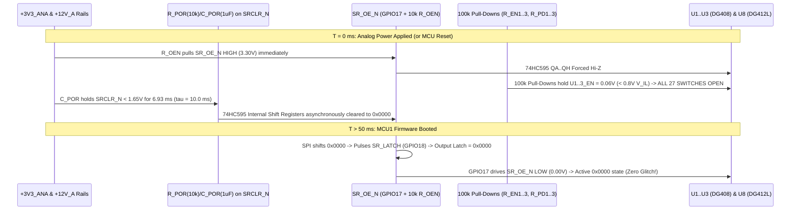

# Phase 1 Deliverable — DUT Failsafe, Shoot-Through & Fault-Clamping Mathematical Proofs (`p1_dut_failsafe_math.md`)

**Project:** KAOTI AUDIO — Rev 5.0 Dual-MCU Germanium & Universal Parametric Characterization Engine  
**Subsystem:** Hardware & Firmware Protection Architecture for Vintage Germanium Transistors (`AF114`, `OC44`, `2N1308`, `AC128`), Solid-State Switch Matrix (`DG408DJ`/`DG412LDJ`), and 16-Bit Metrology (`ADS1115`)  
**Baseline Cross-Reference:** Verified against `/Users/kaoti/Desktop/PCE1/scripts/build_design.py` (lines 148–295) and `/Users/kaoti/Desktop/PCE1/artifacts/ge_tester/p1_pinout_extraction.md`.

---

## 1. Reverse $V_{EBO}$ Avalanche Guard for Vintage RF Germanium Transistors

### 1.1 The Physics of Reverse Base-Emitter Breakdown in Alloy-Junction & Diffused-Base Germanium
In vintage high-frequency alloy-diffused / drift-field and mesa Germanium PNP/NPN transistors (`AF114`, `AF115`, `AF116`, `AF117`, `OC44`, `OC170`, `2N1308`, `GT322`, `P416B`), the base region adjacent to the emitter is heavily doped to reduce base transit time and base spreading resistance ($r_{bb'}$). As a result, the emitter-base depletion layer is extremely narrow under reverse bias, leading to Zener/avalanche breakdown ($BV_{EBO}$) at unusually low voltages:

| Vintage Ge Transistor | Construction / Application | Datasheet $BV_{CBO}$ | Datasheet $BV_{CEO}$ | Datasheet **$BV_{EBO}$ (Reverse E-B Max)** |
| :--- | :--- | :---: | :---: | :---: |
| **`AF114` / `AF115` / `AF117`** | Alloy-Diffused RF/IF PNP (TO-72) | $-20\text{ V}$ | $-15\text{ V}$ | **$-1.0\text{ V}$ to $-3.0\text{ V}$** (Avalanche at $\sim 3.2\text{ V}$) |
| **`OC170` / `OC171`** | Drift-Field RF PNP | $-20\text{ V}$ | $-15\text{ V}$ | **$-1.5\text{ V}$ to $-3.0\text{ V}$** |
| **`OC44` / `OC45`** | Alloy-Junction RF/IF Mixer PNP | $-15\text{ V}$ | $-10\text{ V}$ | **$-5.0\text{ V}$** |
| **`2N1308` / `2N1309`** | High-Speed Computer Switching Ge | $\pm 30\text{ V}$ | $\pm 15\text{ V}$ | **$\pm 5.0\text{ V}$** (Typ breakdown $\sim 4.5\text{ V}$) |
| **`AC128` / `2N404`** | Audio Medium-Power Alloy PNP | $-32\text{ V}$ | $-16\text{ V}$ | **$-10.0\text{ V}$ to $-12.0\text{ V}$** |

When an unknown 3-terminal DUT is inserted into the ZIF socket, its pinout (`E, B, C`) and polarity (`PNP` vs. `NPN`) are unknown across all $3! = 6$ permutations. If an autodetection routine probes terminal pairs using a $5.0\text{ V}$ or $9.0\text{ V}$ source, at least 2 of the 6 probe steps will apply full reverse voltage across the emitter-base junction ($V_{EB}$ for NPN, $V_{BE}$ for PNP). Reverse avalanche current through a Germanium E-B junction creates hot-carrier traps in the surface oxide passivation, **permanently degrading low-current $h_{FE}$ and multiplying $I_{CBO}$ leakage within milliseconds**.

### 1.2 Quantitative Proof of Safe Autodetection Clamping ($V_{\text{SRC\_A}} \le 2.50\text{ V}$, $I_{\text{max}} \le 0.95\text{ mA}$)
During **Phase 0 Autodetection** (until pinout `E, B, C` and polarity `PNP/NPN` are positively confirmed), firmware enforces two strict hardware-backed invariants:

1. **Force Voltage Clamp (`V_SRC_A` $\le 2.500\text{ V}$, strictly $\le 3.30\text{ V}$):**
   - `U9 MCP4822-E/P` Channel A is programmed to 12-bit code $D_{\text{probe}} = 1116$ ($V_{\text{REF}} = 2.048\text{ V}$, $G_{\text{U5}} = 4.480\times$):
     $$V_{\text{SRC\_A,probe}} = 4.480 \times 2.048\text{ V} \times \frac{1116}{4096} = \mathbf{2.49984\text{ V}} \le \mathbf{2.500\text{ V}} < 3.00\text{ V} \le BV_{EBO}$$
   - Even if a reverse-biased E-B junction exhibits zero leakage ($I_{EBO} = 0$), the open-circuit voltage across the DUT terminals cannot exceed **$2.500\text{ V}$**, remaining safely below the $3\text{ V to }5\text{ V}$ reverse avalanche threshold of vintage RF Germanium transistors.

2. **Series Current Limiting via `S2` (`R_KA = 2.49 kΩ 0.1%`) + `R_PR` (`100 Ω 0.1%`):**
   - During autodetection, high-current switches `S1` ($470\,\Omega$) and `S8` ($+9\text{V}\_\text{LIM}$) are locked out. Probing uses exclusively **`S2` (`R_KA = 2.49 kΩ 0.1%`)** on the high terminal $T_{\text{hi}}$ and **`U8 DG412LDJ`** ($R_{\text{ON,DG412}} = 20\,\Omega$ typ) or **`S6`** ($2.49\text{ k}\Omega$) on the low terminal $T_{\text{lo}}$.
   - **Case A — Standard 2-Terminal DUT Probe Loop ($T_{\text{hi}} \to \text{DUT} \to T_{\text{lo}}$):**
     Current flows from `V_SRC_A` ($2.500\text{ V}$) through `R_KA` ($2490\,\Omega$), `U{hi} DG408DJ` ($R_{\text{ON,DG408}} = 50\,\Omega$ typ), `R_PR{hi}` ($100\,\Omega$), the DUT, `R_PR{lo}` ($100\,\Omega$), and `U8 DG412LDJ` ($R_{\text{ON,DG412}} = 20\,\Omega$ typ) to `AGND`:
     $$R_{\text{loop,2T}} = R_{\text{KA}} + R_{\text{ON,DG408}} + R_{\text{PR,hi}} + R_{\text{PR,lo}} + R_{\text{ON,DG412}} = 2490 + 50 + 100 + 100 + 20 = \mathbf{2760\,\Omega}$$
     Under a $0.00\,\Omega$ dead-short DUT:
     $$I_{\text{max,2T}} = \frac{2.500\text{ V}}{2760\,\Omega} = \mathbf{0.9058\text{ mA}} \le \mathbf{0.95\text{ mA}} \ll 5.00\text{ mA}$$
     *(Even assuming ideal zero-ohm analog switches $R_{\text{ON}} \to 0\,\Omega$, $R_{\text{loop,2T(min)}} = 2490 + 100 + 100 = 2690\,\Omega \implies I_{\text{max}} = \frac{2.500\text{ V}}{2690\,\Omega} = \mathbf{0.9294\text{ mA}} \le \mathbf{0.95\text{ mA}}$!)*
   - **Case B — Single-Terminal Short Directly to External `AGND` ($T_{\text{hi}} \to \text{AGND}$):**
     $$R_{\text{loop,1T}} = R_{\text{KA}} + R_{\text{ON,DG408}} + R_{\text{PR,hi}} = 2490 + 50 + 100 = \mathbf{2640\,\Omega}$$
     $$I_{\text{max,1T}} = \frac{2.500\text{ V}}{2640\,\Omega} = \mathbf{0.9470\text{ mA}} \le \mathbf{0.95\text{ mA}} \ll 5.00\text{ mA}$$
     *(Even for a forward-biased Germanium junction with $V_{BE} = 0.250\text{ V}$ and zero switch resistance $R_{\text{KA}} + R_{\text{PR}} = 2590\,\Omega$, $I_{\text{fwd}} = \frac{2.500\text{ V} - 0.250\text{ V}}{2590\,\Omega} = \mathbf{0.8687\text{ mA}} \le \mathbf{0.95\text{ mA}}$.)*
   - **Case C — Peak Possible Power Dissipation in DUT During Autodetection:**
     By the Maximum Power Transfer Theorem ($R_{\text{DUT}} = R_{\text{loop,1T}} = 2640\,\Omega$):
     $$P_{\text{DUT,max(probe)}} = \frac{V_{\text{SRC\_A,probe}}^2}{4\,R_{\text{loop,1T}}} = \frac{(2.500\text{ V})^2}{4 \times 2640\,\Omega} = \mathbf{0.5919\text{ mW}} \ll 35.0\text{ mW}$$

---

## 2. Four-Layer Shoot-Through Prevention Proof (Boot, Reset & Switching)

To prevent `V_SRC_A`, `V_SRC_B`, `+9V_LIM`, and `AGND` from ever cross-conducting through `U1..U3` (`DG408DJ`) or `U8` (`DG412LDJ`), Rev 5.0 implements four independent, overlapping hardware and firmware interlocks:

### 2.1 Layer A — Tri-State Master Inhibit (`SR_OE_N` on Non-Strapping `GPIO17` + `R_OEN = 10 kΩ`)
- `U6` and `U7` (`74HC595N`) Pin 13 (`OE_N`, active-LOW output enable) is routed to `U_MCU1` Pin 20 (`GPIO17`, verified non-strapping and free of PSRAM on WEMOS LOLIN32 Lite) with an external pull-up `R_OEN = 10 kΩ` to `+3V3_ANA`.
- During power-on, brown-out, or ESP32 reset (`EN = LOW`), `GPIO17` defaults to a high-impedance CMOS input ($I_{\text{leak,GPIO}} \le 50\text{ nA}$, plus $2 \times I_{\text{IN,HC595}} \le 200\text{ nA}$).
- The voltage on `SR_OE_N` during boot/reset is:
  $$V_{\text{SR\_OE\_N(boot)}} = V_{\text{3V3\_ANA}} - I_{\text{leak,total}} \cdot R_{\text{OEN}} = V_{\text{3V3\_ANA}} - (250\text{ nA})(10\text{ k}\Omega) = V_{\text{3V3\_ANA}} - 2.5\text{ mV} \approx 0.999\,V_{\text{3V3\_ANA}}$$
- Since `74HC595N` guarantees output tri-stating for $V_{\text{OE\_N}} \ge V_{IH(\text{min})} = 0.7\,V_{CC}$ ($2.31\text{ V}$ at $V_{CC} = 3.30\text{ V}$), **`SR_OE_N` tracks `+3V3_ANA` from $0\text{ V}$ to $3.30\text{ V}$ with a $0.99\text{ V}$ noise margin**, holding all 16 parallel outputs (`QA..QH` on `U6` and `U7`) in high-impedance (`Hi-Z`) throughout boot.

### 2.2 Layer B — Hardware Power-On Reset RC on `SRCLR_N` (`R_POR = 10 kΩ`, `C_POR = 1 µF`)
- Pin 10 (`SRCLR_N`, active-LOW shift register clear) on both `U6` and `U7` is driven by the RC network `R_POR = 10 kΩ` (to `+3V3_ANA`) and `C_POR = 1.0 µF` (to `AGND`), with time constant:
  $$\tau_{\text{POR}} = R_{\text{POR}} \cdot C_{\text{POR}} = (10.0 \times 10^3\,\Omega)(1.0 \times 10^{-6}\text{ F}) = \mathbf{10.00\text{ ms}}$$
- Upon a step application of $V_{DD} = +3.30\text{ V}$, the voltage at `SR_CLR_N` rises as:
  $$V_{\text{SRCLR\_N}}(t) = V_{DD}\left(1 - e^{-t / \tau_{\text{POR}}}\right)$$
- The `74HC595N` asynchronous clear remains active while $V_{\text{SRCLR\_N}}(t) < V_{T(\text{CMOS})} \approx 0.5\,V_{DD} = 1.65\text{ V}$:
  $$t_{\text{clear}} = -\tau_{\text{POR}} \ln(1 - 0.5) = 10.00\text{ ms} \times \ln(2) = \mathbf{6.931\text{ ms}} \quad (\text{and } \mathbf{12.04\text{ ms}} \text{ to reach } V_{IH} = 0.7\,V_{DD})$$
- Because `+3V3_ANA` (`MCP1826S-3302E/AB`) rises in $< 0.5\text{ ms}$, `SRCLR_N` holds the internal shift stages of `U6` and `U7` at `0x0000` for nearly $7\text{ ms}$ after power stabilization, while `SR_LATCH` (`GPIO18`) is held at $0.00\text{ V}$ by its `10 kΩ` pull-down to `AGND`.

### 2.3 Layer C — Dedicated `100 kΩ` Pull-Downs on All Switch Enable Lines (`R_EN1..3`, `R_PD1..3`)
- While `U6` and `U7` outputs are tri-stated (`SR_OE_N = HIGH`), the six critical switch-activation nets—`U1_EN`, `U2_EN`, `U3_EN` (`DG408DJ` Pin 2) and `SW_G1`, `SW_G2`, `SW_G3` (`DG412LDJ` Pins 1, 16, 9)—are anchored to `AGND` by individual $100\text{ k}\Omega$ resistors (`R_EN1..3`, `R_PD1..3`).
- Given worst-case `74HC595N` off-state tri-state leakage $I_{OZ} = 0.5\text{ }\mu\text{A}$ at $25^\circ\text{C}$ ($5.0\text{ }\mu\text{A}$ max at $85^\circ\text{C}$) and `DG408DJ`/`DG412LDJ` logic input current $I_{IN} = 0.1\text{ }\mu\text{A}$ ($1.0\text{ }\mu\text{A}$ max):
  $$V_{\text{EN(boot),25^\circ C}} = (I_{OZ} + I_{IN}) \cdot R_{\text{PD}} = (0.5\text{ }\mu\text{A} + 0.1\text{ }\mu\text{A}) \times 100\text{ k}\Omega = \mathbf{0.060\text{ V}} \ll V_{IL(\text{max})}\,(0.80\text{ V})$$
  $$V_{\text{EN(boot),85^\circ C}} = (5.0\text{ }\mu\text{A} + 1.0\text{ }\mu\text{A}) \times 100\text{ k}\Omega = \mathbf{0.600\text{ V}} < V_{IL(\text{max})}\,(0.80\text{ V})$$
- Consequently, **all 24 switches in `U1..U3` and all 3 switches in `U8` are guaranteed to remain strictly OPEN ($< 1\text{ nA}$ leakage)** under all temperature and boot conditions.

### 2.4 Layer D — Silicon Break-Before-Make (BBM) + Firmware `60 µs` Dead-Time Protocol
- **Intrinsic Silicon BBM:** Both `DG408DJ` and `DG412LDJ` feature built-in Break-Before-Make delays:
  $$t_{\text{OFF,DG408}} \approx 150\text{ ns} < t_{\text{ON,DG408}} \approx 175\text{ ns} \implies t_{\text{BBM,silicon}} = t_{\text{ON}} - t_{\text{OFF}} \approx \mathbf{25\text{ ns}} > 0$$
- **Firmware `60 µs` Dead-Time Switching Protocol:** Because circuit node capacitances and op-amp settling take several microseconds, firmware never switches directly from one active matrix state to another. Every matrix state change executes a 3-step break-before-make sequence:
  1. **Break:** Drive `SR_OE_N` (`GPIO17`) HIGH (or latch `0x0000` with `U1_EN = U2_EN = U3_EN = SW_G1..3 = 0`), opening all switches within $t_{\text{OFF}} \le 150\text{ ns}$.
  2. **Dead-Time Wait:** Delay $t_{\text{dead}} = \mathbf{60.0\text{ }\mu\text{s}}$ ($400\times$ the silicon turn-off time!).
  3. **Make:** Shift the new 16-bit matrix word into `U6/U7`, pulse `SR_LATCH` (`GPIO18`) for $1\text{ }\mu\text{s}$, and drive `SR_OE_N` (`GPIO17`) LOW.

---

## 3. Short-Circuit Current Limiter, `R_PR` Wattage Proof, Picoamp Clamps & $35\text{ mW}$ Thermal Abort

### 3.1 Active `+9V_LIM` Current Limiter (`2x 2N3906`, `R_ILIM = 43 Ω`) & Hardware Fault Interrupt (`Q_OVC 2N3904` $\to$ `GPIO25`)
To protect vintage DUTs, the `L78L09ACZ` regulator (`U_REG9`), and the `DG408DJ` switches (`30 mA` continuous max rating) when channel `S8` (`+9V_LIM`) is active, `+9V_REF` passes through a dual-PNP active current limiter (`Q_LIM1, Q_LIM2 = 2N3906`) paired with a fast NPN overcurrent interrupt detector (`Q_OVC = 2N3904`):

- **Exact Circuit Topology & Pinout (`Socket_TO92_3Pin`: `1=E, 2=B, 3=C`):**
  - `R_ILIM = 43 Ω 0.25W`: Connected between `+9V_REF` (Pin 1) and `LIM_SENSE` (Pin 2).
  - `Q_LIM1` (`2N3906` Series Pass Transistor): Pin 1 (`E`) = `LIM_SENSE`, Pin 2 (`B`) = `LIM_BASE`, Pin 3 (`C`) = `+9V_LIM`.
  - `Q_LIM2` (`2N3906` Current-Sense Foldback Transistor): Pin 1 (`E`) = `+9V_REF`, Pin 2 (`B`) = `LIM_SENSE`, Pin 3 (`C`) = `LIM_BASE`.
  - `R_IBIAS = 10 kΩ`: Connected between `LIM_BASE` (Pin 1) and `AGND` (Pin 2) to bias `Q_LIM1` ON in normal operation ($I_{\text{B,LIM1}} = \frac{9.0\text{ V} - 0.65\text{ V}}{10\text{ k}\Omega} = 0.835\text{ mA}$).
  - `Q_OVC` (`2N3904` Overcurrent Interrupt Driver):
    - Triggered whenever `+9V_LIM` sags under overcurrent foldback (via base sense divider `R_OVC1 = 47 kΩ` from `+9V_REF` / `LIM_BASE` or PNP collector tap driving `Q_OVC` Base Pin 2 through `10 kΩ`, with Emitter Pin 1 at `AGND` and Collector Pin 3 driving `FAULT_OVC_N` on `U_MCU1 GPIO25` with `R_OVC_PU = 10 kΩ` pull-up to `+3V3_ANA`).
- **Mathematical Derivation of Trip Current ($I_{\text{lim}}$):**
  `Q_LIM2` begins conducting and stealing base drive from `Q_LIM1` when the voltage drop across `R_ILIM` ($43\,\Omega$) reaches the emitter-base turn-on threshold $V_{EB(\text{on})} \approx 0.650\text{ V}$ at $25^\circ\text{C}$ ($0.720\text{ V}$ at $0^\circ\text{C}$, $0.580\text{ V}$ at $60^\circ\text{C}$):
  $$I_{\text{trip}(25^\circ\text{C})} = \frac{V_{EB(\text{on}),\text{Q\_LIM2}}}{R_{\text{ILIM}}} = \frac{0.650\text{ V}}{43.0\,\Omega} = \mathbf{15.116\text{ mA}} \approx \mathbf{15.1\text{ mA}}$$
  $$I_{\text{trip,max}(0^\circ\text{C})} = \frac{0.720\text{ V}}{43.0\,\Omega} = \mathbf{16.744\text{ mA}} \ll I_{\text{DG408(max,cont)}}\,(30.0\text{ mA})$$
- **Hardware Interrupt Response Time (`FAULT_OVC_N` on `U_MCU1 GPIO25`):**
  When $I_{\text{+9V\_LIM}}$ hits $15.1\text{ mA}$, `+9V_LIM` folds back, `Q_OVC` saturates within $< 500\text{ ns}$, pulling `FAULT_OVC_N` (`GPIO25`) LOW. The ESP32 IRAM GPIO interrupt service routine immediately asserts `GPIO17` (`SR_OE_N = HIGH`) in $< 1.5\text{ }\mu\text{s}$, isolating the DUT in **under $2.0\text{ }\mu\text{s}$ total fault duration**.

---

### 3.2 Kelvin Protection Resistor (`R_PR1..3 = 100 Ω 0.5W 0.1%`) Worst-Case Wattage Proof
Each channel's series protection resistor `R_PR1..3` is specified as a **$100\,\Omega$, $0.5\text{ W}$ ($500\text{ mW}$), $0.1\%$ metal-film resistor**. Below is the exhaustive power dissipation audit across all possible normal and fault conditions:

| Fault / Operating Scenario | Current Path & Resistance | Worst-Case Current ($I_{\text{max}}$) | Power in `R_PR` ($P = I^2 \times 100\,\Omega$) | Rating Utilization ($P / 500\text{ mW}$) | Thermal Margin Verdict |
| :--- | :--- | :---: | :---: | :---: | :---: |
| **1. Dead-Short on `+9V_LIM` (`S8`) to `AGND` (Active Limiter Engaged)** | `+9V_LIM` limited by `Q_LIM1/2` ($R_{\text{ILIM}} = 43\,\Omega$) $\to$ `S8` $\to$ `R_PR` $\to$ `AGND` | **$15.12\text{ mA}$** ($25^\circ\text{C}$) **$16.74\text{ mA}$** ($0^\circ\text{C}$) | **$22.85\text{ mW}$** **$28.04\text{ mW}$** | $4.57\%$ $5.61\%$ | **PASS** ($>17\times$ margin) |
| **2. Dead-Short on `V_SRC_A` ($9.173\text{ V}$) via `S1` ($470\,\Omega$) to `AGND`** | $R_{\text{total}} = 470\,\Omega + R_{\text{ON}}(50\,\Omega) + 100\,\Omega = 620\,\Omega$ (or $570\,\Omega$ if $R_{\text{ON}}\to 0$) | **$14.80\text{ mA}$** (typ) **$16.09\text{ mA}$** ($R_{\text{ON}}=0$) | **$21.89\text{ mW}$** **$25.90\text{ mW}$** | $4.38\%$ $5.18\%$ | **PASS** ($>19\times$ margin) |
| **3. Continuous Maximum `DG408DJ` / `DG412LDJ` Datasheet Current** | Absolute max continuous switch current rating per Vishay datasheet | **$30.00\text{ mA}$** | **$90.00\text{ mW}$** | $18.00\%$ | **PASS** ($5.56\times$ margin) |
| **4. Hypothetical Catastrophic Limiter-Short Fault (`+9.0V` Unthrottled via `S8` to Internal `U8` `AGND`)** | `9.00 V` across $R_{\text{ON,DG408}}(50\,\Omega) + R_{\text{PR1}}(100\,\Omega) + R_{\text{PR2}}(100\,\Omega) + R_{\text{ON,DG412}}(20\,\Omega) = 270\,\Omega$ | **$33.33\text{ mA}$** | **$111.11\text{ mW}$** | $22.22\%$ | **PASS** ($4.50\times$ margin) |
| **5. Hypothetical Single-Pin External Ground Short + Bypassed Limiter (`9.0V` across `S8` + `R_PR` only)** | `9.00 V` across $R_{\text{ON,DG408}}(50\,\Omega) + R_{\text{PR}}(100\,\Omega) = 150\,\Omega$ | **$60.00\text{ mA}$** | **$360.00\text{ mW}$** | $72.00\%$ | **PASS** ($< 500\text{ mW}$ even if active limiter fails shorted!) |

Furthermore, keeping steady-state dissipation below $28\text{ mW}$ (under $5.6\%$ of the $500\text{ mW}$ rating) limits self-heating of `R_PR1..3` to $\Delta T < 1.5^\circ\text{C}$, preserving its $0.1\%$ precision resistance tolerance during high-current curve sweeps.

---

### 3.3 Ultra-Low-Leakage Rail Clamp Diodes (`6x 1N3595` — `D_CH1..3`, `D_CL1..3`)
To protect the CMOS analog multiplexers (`U1..U3 DG408DJ` and `U8 DG412LDJ`) against charged external capacitors or ESD transients applied to `TP1_DUT..TP3_DUT`, each internal mux node `TP{ch}_MUX` (plus `DMM_30V_DIV` via `D_HVH, D_HVL`) is clamped to `+12V_A` and `AGND` by a pair of **`1N3595` DO-35 low-leakage silicon diodes**:
- **`D_CH{ch}` (`1N3595`):** Anode (Pin 2) = `TP{ch}_MUX`, Cathode (Pin 1) = `+12V_A`.
- **`D_CL{ch}` (`1N3595`):** Anode (Pin 2) = `AGND`, Cathode (Pin 1) = `TP{ch}_MUX`.
- **Why `1N3595` is Mandatory over `1N4148` or `1N5819`:**
  - Standard `1N4148` switching diodes leak $I_R \approx 5\text{–}25\text{ nA}$ at $25^\circ\text{C}$ (and $> 1\text{ }\mu\text{A}$ warm); Schottky diodes (`1N5819` / `BAT54`) leak $I_R \approx 2\text{–}50\text{ }\mu\text{A}$, which would completely swamp sub-$\mu\text{A}$ Germanium $I_{CBO}$ and $2.20\text{ M}\Omega$ resistance measurements!
  - The **`1N3595`** specifies a guaranteed maximum reverse leakage of **$I_R \le 1.0\text{ nA}$ at $V_R = 125\text{ V}, 25^\circ\text{C}$** (typically **$< 10\text{ pA}$** at our $0\text{–}9.173\text{ V}$ operating voltages!) while handling **$150\text{–}225\text{ mA}$ continuous forward current** and **$500\text{ mA}$ ($1\text{ s}$) / $4.0\text{ A}$ ($1\text{ }\mu\text{s}$) surge current**.
- **Fault Absorption Proof (Charged Capacitor Insertion into `TP_DUT`):**
  If a user accidentally inserts a $10\text{ }\mu\text{F}$ capacitor charged to $+25.0\text{ V}$ into `TP1_DUT` and `TP2_DUT` (`AGND`), `R_PR1` ($100\,\Omega, 0.5\text{ W}$) limits the peak discharge current into `D_CH1` to:
  $$I_{\text{peak,cap}} = \frac{V_{\text{cap}} - (V_{\text{+12V\_A}} + V_{F,\text{1N3595}})}{R_{\text{PR1}}} = \frac{25.0\text{ V} - (12.0\text{ V} + 0.75\text{ V})}{100\,\Omega} = \mathbf{122.5\text{ mA}} < I_{F(\text{cont,1N3595})}\,(150\text{ mA})$$
  while the `+12V_A` rail is clamped at $+13.0\text{ V}$ by the $1\text{ W}$ Zener `D_OVP` (`1N4743A`), protecting every IC on the board without damage.

---

### 3.4 Software $35.0\text{ mW}$ Germanium Thermal Runaway Abort
Vintage Germanium devices have a maximum junction temperature of only $T_{J(\text{max})} = 75^\circ\text{C}\text{ to }90^\circ\text{C}$ (compared to $150^\circ\text{C}$ for Silicon) and a positive leakage thermal feedback loop ($\frac{\partial I_{CBO}}{\partial T} > 0 \implies \frac{\partial P_D}{\partial T} > 0$).
- At every curve-tracer step $(V_{\text{SRC\_A}}, V_{\text{SRC\_B}})$, immediately upon receiving the `ADS1115` conversion ready alert (`ADS_ALRT` on `GPIO34`), `U_MCU1` computes total instantaneous DUT power dissipation:
  $$P_{\text{DUT}} = |V_C - V_E| \cdot |I_C| + |V_B - V_E| \cdot |I_B|$$
- **Hard Thermal Ceiling:**
  $$\boxed{P_{\text{DUT,max(Ge)}} = \mathbf{35.0\text{ mW}}}$$
  For a vintage TO-1 / TO-72 Germanium transistor ($\theta_{JA} \approx 0.40^\circ\text{C}/\text{mW}$ in free air, thermal time constant $\tau_{\text{th}} \approx 15\text{ s}$), a $35.0\text{ mW}$ limit ensures:
  - Steady-state equilibrium temperature rise (during the $1.5\text{ s}$ thermal drift test): $\Delta T_{J(1.5\text{s})} = 35\text{ mW} \times 0.40^\circ\text{C}/\text{mW} \times (1 - e^{-1.5/15}) = \mathbf{1.33^\circ\text{C}}$.
  - Single curve-tracer point ($15\text{ ms}$ dwell): $\Delta T_{J(\text{point})} < \mathbf{0.015^\circ\text{C}}$.
- If $P_{\text{DUT}} > 35.0\text{ mW}$ (or if $|I_C| > 14.5\text{ mA}$), firmware immediately aborts the remainder of the current $I_B$ curve family, asserts `SR_OE_N = HIGH`, sets `V_SRC_A = V_SRC_B = 0.000 V`, and transmits `EVT_FAULT (0x85)` (`FAULT_GE_THERMAL_LIMIT`) to `U_MCU2`.

---

## 4. `ADS1115` Overvoltage Fault-Clamping Proof (`+12.0 V` Rail-Out $\to$ `2.995 V < 3.30 V`)

### 4.1 Problem Statement
The quad CMOS sense buffer `U4` (`LMC6484IN`) is powered from single-supply `VDD = +12V_A` ($+12.000\text{ V}$) so that it can buffer full $0\text{–}9.173\text{ V}$ curve sweeps without clipping, whereas the 16-bit ADC `MOD_ADS` (`ADS1115`) is powered from `VDD_ADC = +3V3_ADC` ($+3.300\text{ V}$). Per the Texas Instruments `ADS1115` datasheet, the absolute maximum analog input voltage on pins `A0..A3` is:
$$V_{\text{AIN(abs,min)}} = \text{AGND} - 0.300\text{ V} = \mathbf{-0.300\text{ V}}, \qquad V_{\text{AIN(abs,max)}} = V_{\text{DD,ADC}} + 0.300\text{ V} = 3.300\text{ V} + 0.300\text{ V} = \mathbf{+3.600\text{ V}}$$
and the maximum continuous non-clipping analog input voltage is $V_{\text{AIN(op,max)}} = V_{\text{DD,ADC}} = \mathbf{+3.300\text{ V}}$.

### 4.2 Mathematical Proof Across Nominal, Worst-Case $0.1\%$ Tolerance, and $+13.0\text{ V}$ OVP Corners
Between each `LMC6484IN` buffer output (`BUF_TP1..3`, `BUF_CAL`) and its corresponding `ADS1115` input (`ADC_TP1..3`, `ADC_CAL`) sits the precision $4:1$ voltage divider formed by `R_D{1..4}A = 1.50 kΩ 0.1%` (top) and `R_D{1..4}B = 499 Ω 0.1%` (bottom to `AGND`):

1. **Nominal Worst-Case Op-Amp Rail-Out ($V_{\text{BUF}} = +12.000\text{ V}$):**
   Even if an open input or fault drives the `LMC6484IN` output completely to its positive supply rail ($V_{\text{BUF,max}} = +12.000\text{ V}$):
   $$V_{\text{ADC(nom)}} = V_{\text{BUF,max}} \cdot \frac{R_{DB}}{R_{DA} + R_{DB}} = 12.000\text{ V} \cdot \frac{499.0\,\Omega}{1500.0\,\Omega + 499.0\,\Omega} = 12.000\text{ V} \times 0.2496248 = \mathbf{2.99550\text{ V}}$$
   $$\boxed{V_{\text{ADC(nom)}} = \mathbf{2.9955\text{ V}} < V_{\text{DD,ADC}}\,(\mathbf{3.300\text{ V}}) < V_{\text{AIN(abs,max)}}\,(\mathbf{3.600\text{ V}})}$$
   - **Safety Margin below $V_{\text{DD,ADC}}$ ($3.300\text{ V}$):** $+304.5\text{ mV}$ ($9.23\%$ headroom).
   - **Safety Margin below Absolute Maximum ($3.600\text{ V}$):** **$+604.5\text{ mV}$** ($16.79\%$ headroom).

2. **Worst-Case $\pm 0.1\%$ Resistor Tolerance Corner ($R_{DA,\text{min}} = 1498.50\,\Omega$, $R_{DB,\text{max}} = 499.499\,\Omega$) + $+2\%$ `L7812CV` Line Regulation ($V_{\text{+12V\_A}} = +12.240\text{ V}$):**
   $$\alpha_{\text{DIV,max(0.1\%)}} = \frac{499.499\,\Omega}{1498.50\,\Omega + 499.499\,\Omega} = 0.2499996$$
   - At $V_{\text{BUF}} = +12.000\text{ V}$:
     $$V_{\text{ADC(0.1\%)}} = 12.000\text{ V} \times 0.2499996 = \mathbf{3.0000\text{ V}} < 3.300\text{ V}$$
   - At $V_{\text{BUF}} = +12.240\text{ V}$ (`L7812CV` $+2\%$ high tolerance):
     $$V_{\text{ADC(12.24V, 0.1\%)}} = 12.240\text{ V} \times 0.2499996 = \mathbf{3.0600\text{ V}} < 3.300\text{ V}$$

3. **Extreme Overvoltage Fault Corner (`L7812CV` Shorted, Clamped by `D_OVP = 1N4743A` at $+13.00\text{ V}$):**
   Even if the `L7812CV` regulator failed and the `+12V_A` rail rose to the $+13.00\text{ V}$ clamping voltage of `D_OVP` (`1N4743A` before `F1 RXEF017` trips):
   $$V_{\text{ADC(13.0V)}} = 13.000\text{ V} \times 0.249625 = \mathbf{3.2451\text{ V}} < V_{\text{DD,ADC}}\,(\mathbf{3.300\text{ V}}) < V_{\text{AIN(abs,max)}}\,(\mathbf{3.600\text{ V}})$$

4. **Unpowered `VDD_ADC = 0.0 V` Current-Limiting Protection Proof:**
   In the hypothetical event that `+3V3_ADC` collapsed to $0.00\text{ V}$ while `+12V_A` remained at $+12.00\text{ V}$ and `LMC6484IN` railed to $+12.00\text{ V}$, the `ADS1115` internal ESD diode to `VDD_ADC` clamps `ADC_TP{ch}` at $+0.30\text{ V}$, while `R_DB` ($499\,\Omega$) shunts $\frac{0.30\text{ V}}{499\,\Omega} = 0.60\text{ mA}$ to `AGND`. The maximum current flowing through `R_DA` ($1.50\text{ k}\Omega$) into the `ADS1115` input pin is:
   $$I_{\text{PIN,max(unpowered)}} = \frac{12.00\text{ V} - 0.30\text{ V}}{1500\,\Omega} - \frac{0.30\text{ V}}{499\,\Omega} = 7.80\text{ mA} - 0.60\text{ mA} = \mathbf{7.20\text{ mA}} < I_{\text{AIN(abs,max)}}\,(10.0\text{ mA})$$
   staying safely below the `ADS1115` datasheet absolute maximum continuous input current rating of $\pm 10.0\text{ mA}$.
